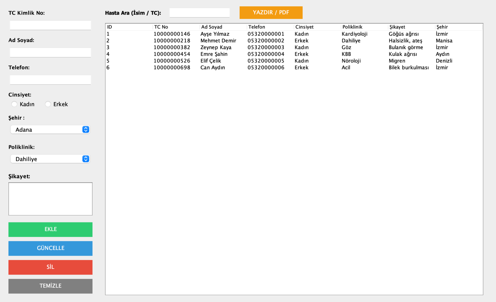

# 🏥 Hasta Kayıt Sistemi

[](https://github.com/kaanyildiz14/hasta-kayit-sistemi/actions/workflows/ci.yml)


Bir hastanenin hasta kabul biriminde kullanılabilecek masaüstü kayıt uygulaması. Hasta bilgilerini kaydeder, günceller, siler, isim veya TC Kimlik No ile anlık arar ve listeyi yazdırır / PDF'e aktarır.


<sub>Ekrandaki kayıtlar hayalidir.</sub>

## ✨ Özellikler

- **Hasta kaydı:** TC Kimlik No, ad soyad, telefon, cinsiyet, şehir (81 il), poliklinik ve şikayet
- **Kayıt yönetimi:** Tablodan seçilen hastayı forma doldurma, güncelleme, silme (onaylı)
- **Anlık arama:** Yazdıkça isim ya da TC numarasına göre filtreleme
- **Yazdırma / PDF:** Hasta listesini sayfa numaralı olarak yazdırma
- **Doğrulama:**
  - TC Kimlik No alanına yalnızca rakam girilebilir, tam 11 hane olmalı
  - Aynı TC numarasıyla ikinci kayıt engellenir (veritabanında `UNIQUE` kısıtı)
  - Ad soyad boş olamaz, telefon en az 10 hane, cinsiyet seçimi zorunlu
- **Güvenlik:** Tüm sorgular `PreparedStatement` ile parametreli; SQL injection'a karşı test edildi

## 🛠️ Teknolojiler

| Katman | Teknoloji |
|---|---|
| Arayüz | Java Swing |
| Veritabanı | SQLite (`sqlite-jdbc`) |
| Derleme | Maven (wrapper ile, kurulum gerektirmez) |
| Test | JUnit 6, her push'ta GitHub Actions |

## 🚀 Çalıştırma

Gereksinim: Java 17 veya üstü

```bash
git clone https://github.com/kaanyildiz14/hasta-kayit-sistemi.git
cd hasta-kayit-sistemi
./mvnw package                        # Windows: mvnw.cmd package
java -jar target/hasta-kayit-sistemi.jar
```

İlk çalıştırmada bulunduğunuz klasörde `hastane.db` veritabanı dosyası otomatik oluşturulur.

## 🧪 Testler

```bash
./mvnw test
```

17 test: form doğrulama kuralları ve her test için geçici bir SQLite dosyası üzerinde ekleme, arama, güncelleme, silme, TC çakışması ve SQL injection denemesi.

## 📁 Yapı

```
src/main/java/hastane/
├── hastane2.java        # Swing arayüzü: form, tablo, butonlar
├── Hasta.java           # Hasta kaydı (record)
├── HastaDogrulama.java  # Form doğrulama kuralları
└── HastaDeposu.java     # SQLite işlemleri (ekle, ara, güncelle, sil)
src/test/java/hastane/   # JUnit testleri
```

Veritabanı işlemleri arayüzden ayrı bir sınıfta (`HastaDeposu`) olduğu için arayüz açılmadan, gerçek bir veritabanıyla test edilebiliyor.

## 📄 Lisans

[MIT](LICENSE)
